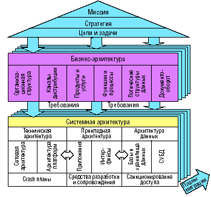
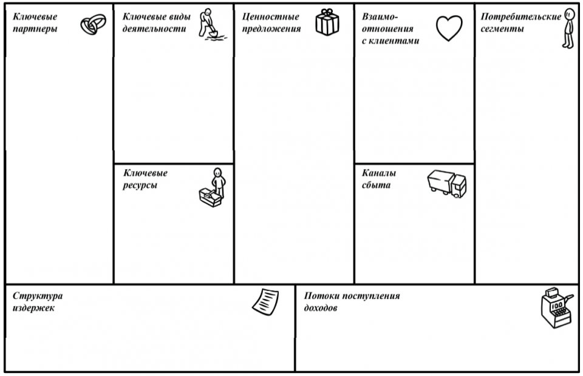
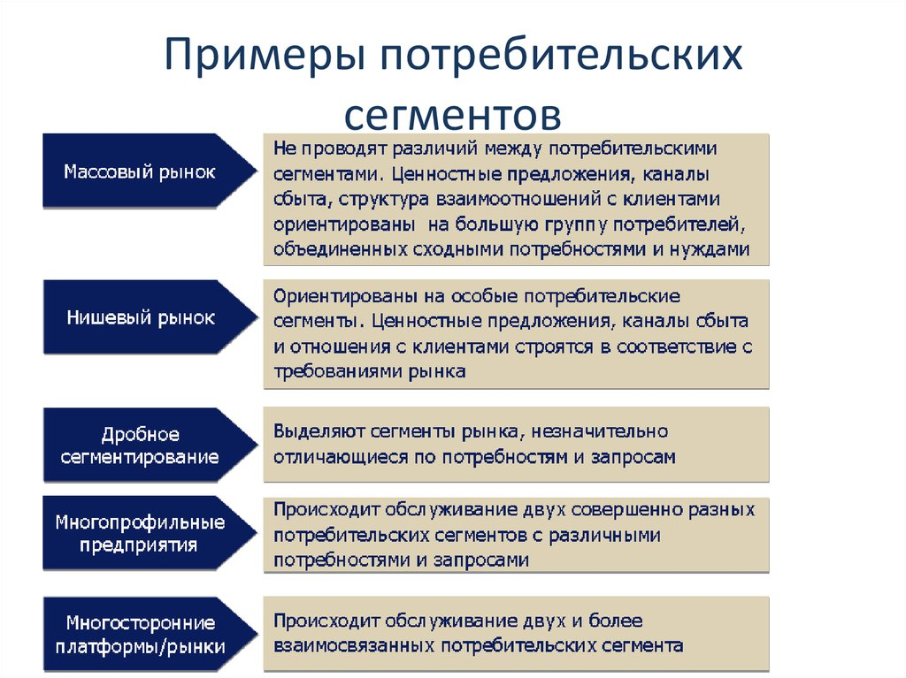
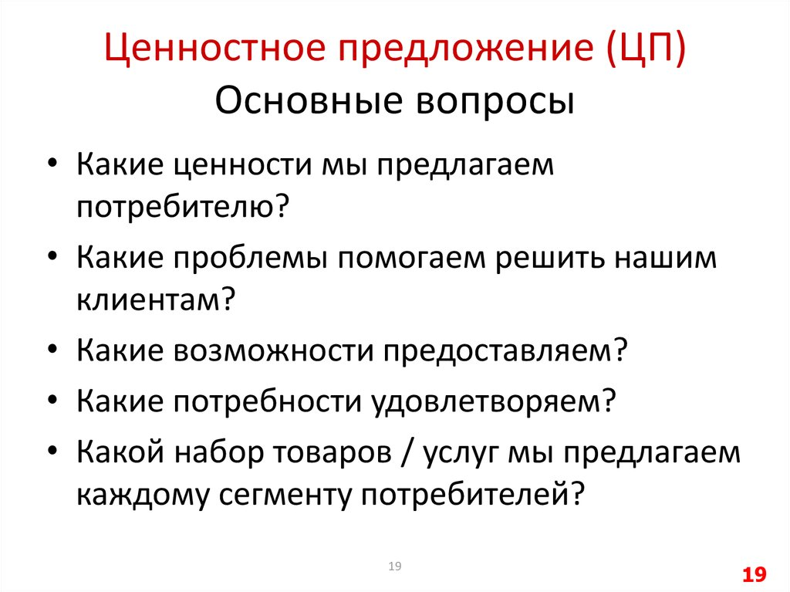
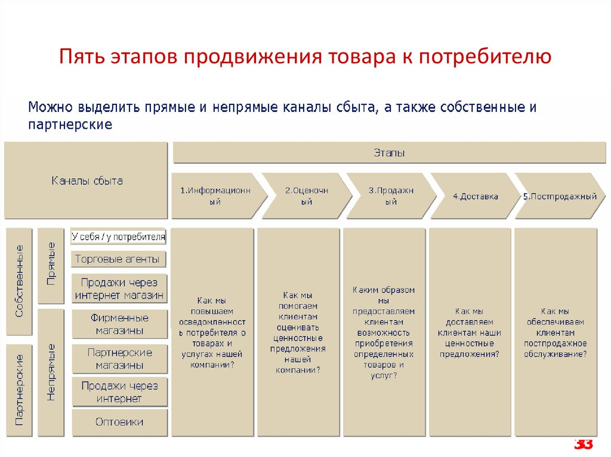
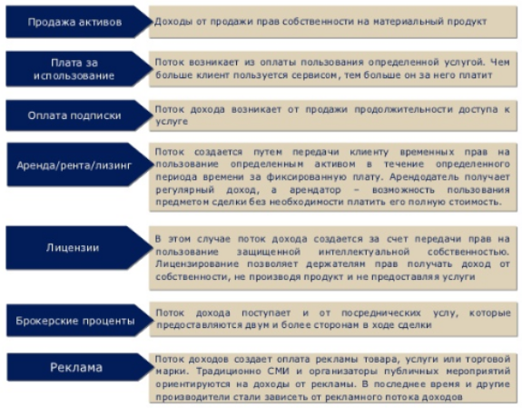

# 2. Бизнес-архитектура

[Презентация](/MyConspector/files/ap/3.pdf)

---

## Архитектура предприятия
::: info Архитектура предприятия

Рассмотрение системы сверху вниз в попытках декомпозировать.
:::

**Архитектура** - моделирование текущего состояния предприятия.

1. Миссия
2. Стратегия
3. Цели и задачи
4. Бизнес-архитектура:
   1. Потребительские сегменты
   2. Ценностное предложение
5. Системная архитектура

## Модель Александра Остервальдера

Бизнес-архитектура

|Блоки модели Остервальдера|Что это такое|
|---|---|
|Ключевые партнеры||
|Ключевые виды деятельности||
|Ключевые ресурсы||
|Ценностное предложение|Товары или услуги, которые представляют ценность для определенного потребительского сегмента|
|Взаимоотношения с клиентами||
|Каналы сбыта||
|Потребительские сегменты|Определяем, кто наш потребитель, кому предлагаем товар/услугу|
|Структура издержек||
|Потоки поступления доходов||

### Потребительские сегменты

Может быть один или несколько сегментов:

- Массовый рынок
- Нишевый рынок
- Дробное сегментирование
- Многопрофильные предприятия
- Многосторонние платформы/рынки

*Что важно знать о рынке*:
- Географическое местоположение
- Средний балл ЕГЭ (ХЫ)
- Возраст
- Профессиональные интересы
- Материальные способности

### Ценностное предложение
Определить товары или услуги, которые представляют ценность для определенного потребительского сегмента.

Ценностные предложения представляют собой совокупность преимуществ товаров (услуг), которые компания готова предложить потребителю.

Преимущества количественного или качественного характера:
- Новизна
- Бренд/статус
- Производительность
- Цена
- Изготовление на заказ
- Уменьшение расходов
- Делать свою работу
- Снижение риска
- Дизайн
- Доступность
- Удобство/применимость

### Каналы сбыта

Определить, как компания взаимодействует с потребительскими сегментами и доносит до них свои ценностные предложения 

Функции:
- Повышают степень осведомленности потребителя о товарах и услугах компании
- Знакомят и помогают оценить ценностные предложения компании
- Позволяют потребителю приобретать товары/услуги
- Обеспечивают послепродажное обслуживание

::: info Примеры:
- торговый зал
- интернет-магазин
- сми
- реклама
- мастер-классы
- сарафанное радио
:::

## Взаимоотношения с клиентами

Описать типы отношений, которые устанавливаются у компании с отдельными потребительскими сегментами

Взаимоотношения могут быть от персональных до автоматизированных.

Описать типы отношений с клиентами в рамках движения по воронке продаж:
- приобретения клиентов
- увеличения продаж
- удержание клиентов

Типы взаимоотношений:
1. Персональная поддержка - тебя знают по имени
2. Особая персональная поддержка - без тебя не смогут взаимодействовать
3. Автоматизированное обслуживание - система поддержки взаимодействия с клиентами
4. Самообслуживание - торговые центры и гипермаркеты, где людей с той стороны нет
5. Сообщества - больше поддержки клиентам не своими руками

## Потоки поступления доходов

Вопросы:
- Какой вклад в прибыль у каждого потока?
- За что платят потребители?
- За что они будут платить?
- За что хотели бы платить?

## Ключевые ресурсы
- Материальные ресурсы
- Интеллектуальные ресурсы
- Персонал
- Финансы

Вопросы:
- Как и где мы используем ресурсы?
- Какие ресурсы нужны для каналов сбыта, ЦП, потоков доходов, взаимоотношений с клиентами? 

## Ключевые виды деятельности

Основными бизнес-процессами являются процессы, ориентированные на производство товара или оказание услуги, являющиеся целевыми объектами создания предприятия и обеспечивающие получение дохода.

**Сопутствующие процессы** — процессы, ориентированные на производство товара или оказание услуги, являющиеся результатами сопутствующей основному производству производственной деятельности и также обеспечивающие получение дохода. 

**Вспомогательные бизнес-процессы** — процессы, предназначенные для обеспечения выполнения основных БП и поддержания их специфических черт. 

**Обеспечивающие бизнес-процессы** — процессы, предназначенные для жизнеобеспечения всех остальных БП и ориентированные на поддержку их универсальных черт.

## Ключевые партнеры
4 типа партнерских отношений:
- Сотрудничество между не конкурирующими компаниями
- Сотрудничество с конкурентами
- СП для новых бизнес проектов
- Поставщик-потребитель

## Структура издержек

Главная цель - минимизировать издержки

- С преимущественным вниманием к издержкам
- С преимущественным вниманием к ценностям