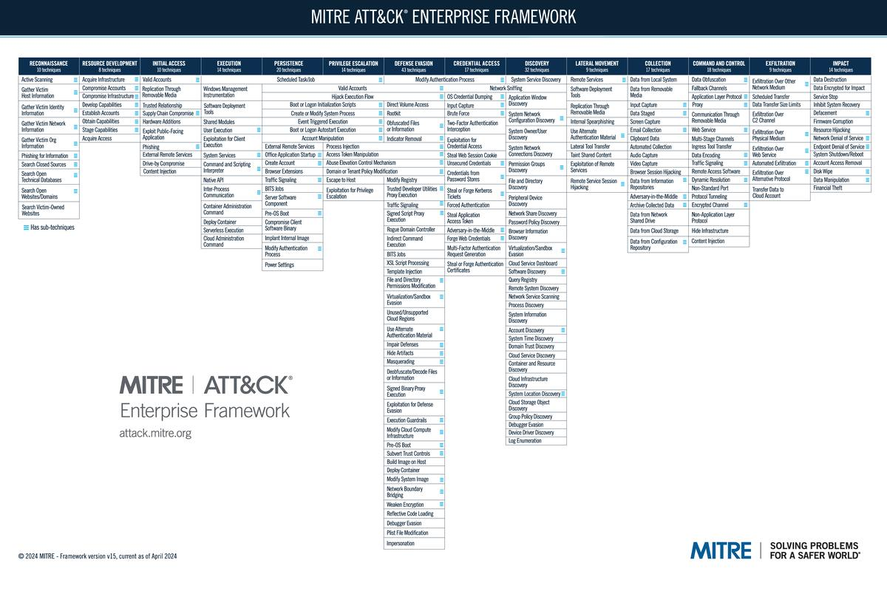

# MITRE ATT&CK® 

**<highlight>MITRE ATT&CK</highlight>** — это своего рода словарь поведения киберпреступников. Он помогает перейти от общего утверждения «система может подвергнуться атаке» к более конкретным вопросам: каким способом могут проникнуть в систему, что злоумышленник может делать после проникновения и как это обнаружить.

[Статейка на Хабре по теме](https://habr.com/ru/companies/pt/articles/597581/?ysclid=mvbavorlhy516541096)

## Что такое MITRE ATT&CK?

**MITRE ATT&CK** — это общедоступная база знаний о тактиках и техниках, которые злоумышленники используют при проведении кибератак. Она помогает специалистам по информационной безопасности понимать, как действуют атакующие, какие методы они применяют и как обнаруживать или предотвращать их действия.

Если NIST SP 800-30 помогает **оценивать риски**, то MITRE ATT&CK помогает разобраться в **конкретных действиях злоумышленников во время атаки**.

[Официальный сайт](https://attack.mitre.org)

## Как расшифровывается MITRE ATT&CK?

- **MITRE** — название организации, которая развивает эту базу знаний.
- **ATT&CK** — *Adversarial Tactics, Techniques, and Common Knowledge*, то есть тактики, техники и общие сведения о действиях противника.

Это **структурированная модель поведения атакующих**, которую используют при расследовании инцидентов, построении систем обнаружения угроз и тестировании защиты.

## Из чего состоит MITRE ATT&CK?

В основе модели лежат четыре основных понятия: тактики, техники, подтехники и процедуры.

### Тактика (Tactic)

**Вопрос: зачем атакующий выполняет действие?**

Пример: получить первоначальный доступ к системе.

### Техника (Technique)

**Вопрос: каким способом атакующий пытается достичь своей цели?**

Пример: использовать фишинговое письмо для проникновения в систему.

### Подтехника (Sub-technique)

**Вопрос: какой более конкретный вариант техники используется?**

Например, фишинговое письмо может содержать вредоносное вложение или ссылку.

### Процедура (Procedure)

**Вопрос: как именно конкретный атакующий реализовал технику?**

Например, определённая группа злоумышленников использовала конкретный сценарий фишинговой атаки.

## Матрица MITRE ATT&CK

Главный инструмент для работы с моделью — матрица, в которой столбцы соответствуют тактикам атакующего, а внутри них перечислены техники и подтехники.

[Официальная матрица Enterprise](https://attack.mitre.org/matrices/enterprise)

Для корпоративных систем особенно важна матрица **Enterprise ATT&CK**. Она охватывает различные среды, включая Windows, Linux, macOS, облачную инфраструктуру и корпоративные сети. Существуют также отдельные матрицы для мобильных устройств и промышленных систем.

### Основные тактики

| Тактика | Что пытается сделать злоумышленник |
|---|---|
| Reconnaissance — разведка | Собрать сведения о цели |
| Initial Access — первоначальный доступ | Проникнуть в систему |
| Execution — выполнение | Запустить вредоносные команды или код |
| Persistence — закрепление | Сохранить доступ после перезапуска или других изменений |
| Privilege Escalation — повышение привилегий | Получить более высокие права |
| Defense Evasion — обход защиты | Скрыть действия от средств обнаружения |
| Credential Access — получение учётных данных | Завладеть паролями, токенами или другими данными аутентификации |
| Discovery — изучение окружения | Выяснить, какие ресурсы доступны |
| Lateral Movement — горизонтальное перемещение | Перейти на другие устройства или системы |
| Collection — сбор данных | Собрать нужную информацию |
| Command and Control — управление | Поддерживать связь с скомпрометированной системой |
| Exfiltration — утечка данных | Вывести информацию за пределы организации |
| Impact — воздействие | Нарушить работу системы, повредить или уничтожить данные |

Злоумышленник может пропускать некоторые тактики, возвращаться к предыдущим или применять их в разном порядке.

## Для чего используют MITRE ATT&CK?

### Обнаружение атак

Помогает создавать правила мониторинга для SIEM и EDR, чтобы выявлять подозрительные действия, соответствующие известным техникам.

### Расследование инцидентов

Позволяет описывать поведение злоумышленника в единой терминологии и восстанавливать возможный ход атаки.

### Оценка защищённости

Помогает определить, какие техники организация способна обнаруживать, а какие остаются незамеченными.

### Проверка защиты

Используется при моделировании действий атакующих и тестировании защитных механизмов в контролируемых условиях.

Для визуализации покрытия защитных мер существует бесплатный инструмент **ATT&CK Navigator**. В нём можно отмечать техники, проверенные организацией, выявлять пробелы и сравнивать результаты проверок.

[Инструмент](https://mitre-attack.github.io/attack-navigator)